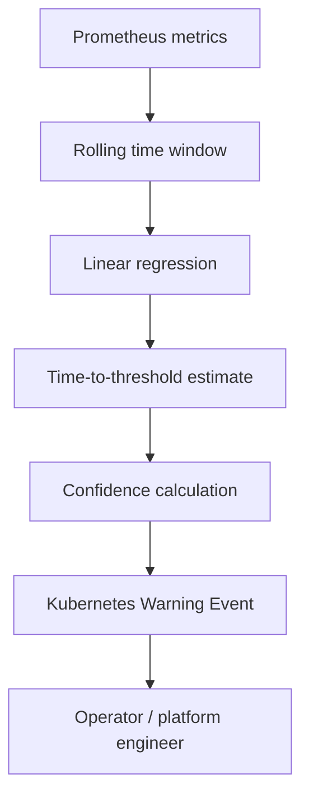

# Kubernetes Platform Intelligence

A Kubernetes operator experiment for estimating node memory pressure from Prometheus time-series data and surfacing an early warning through native Kubernetes Events.

The project explores a narrow platform engineering question: can a trend in available node memory provide a useful warning before Kubernetes reports `MemoryPressure` and begins evicting workloads?

> **Scope:** this is an experimental, observe-only project. It does not automatically change workloads or node configuration and is not presented as production-ready.

## What it does

The operator:

1. Queries Prometheus for `node_memory_MemAvailable_bytes` and `node_memory_MemTotal_bytes`.
2. Evaluates a rolling time window using a simple linear regression.
3. Estimates when available memory may reach a configured threshold.
4. Derives a confidence value from the estimate.
5. Emits a Kubernetes Warning Event named `PredictedMemoryPressure`.

The implementation uses basic regression and signal interpretation rather than a complex forecasting model.

## Processing flow



## Configuration

The operator is configured through a `PlatformHealthCheck` custom resource.

```yaml
apiVersion: platformintel.example.com/v1alpha1
kind: PlatformHealthCheck
metadata:
  name: default
  namespace: platform-intelligence
spec:
  windowMinutes: 45
  stepSeconds: 60
  warnHours: 4
  thresholdAvailableRatio: 0.10
```

The example values define a 45-minute observation window, a 60-second query step, a four-hour warning horizon and a 10% available-memory threshold. Adjust these values for the environment being tested.

## Example event

```text
Warning  PredictedMemoryPressure  node/minikube
[OBSERVE] Prediction: node 'minikube' low MemAvailable in ~2.90h (confidence=28%).
Recommendation: Observe only (log + learn).
```

This is an illustrative event from a Minikube test, not a benchmark or a service-level guarantee.

## Current status

- Tested on Minikube
- Prometheus metrics used as input
- Linear-regression trend estimate
- Custom resource configuration
- Native Kubernetes Warning Events
- Operator metrics exposed for monitoring
- Observe-only behavior; no automated remediation

## Engineering notes

- Kubernetes Events are useful for surfacing operator decisions in the same interface used by cluster operators.
- Time-series predictions depend heavily on signal quality, sampling intervals and workload behavior.
- A prediction should be treated as a hint for investigation, not as proof that a node will reach a threshold.
- Any future remediation path needs independent policy checks, explicit limits and a safe default.

## Next steps

- Evaluate noisy and missing metric samples.
- Test on a multi-node cluster with varied workload patterns.
- Compare the current regression heuristic with a baseline anomaly detector.
- Measure false positives and warning lead time before changing the observe-only behavior.

## Related project

[k3s-ai-remediation](https://github.com/sunkaradp/k3s-ai-remediation) explores a separate, policy-gated remediation workflow for Kubernetes incidents.
